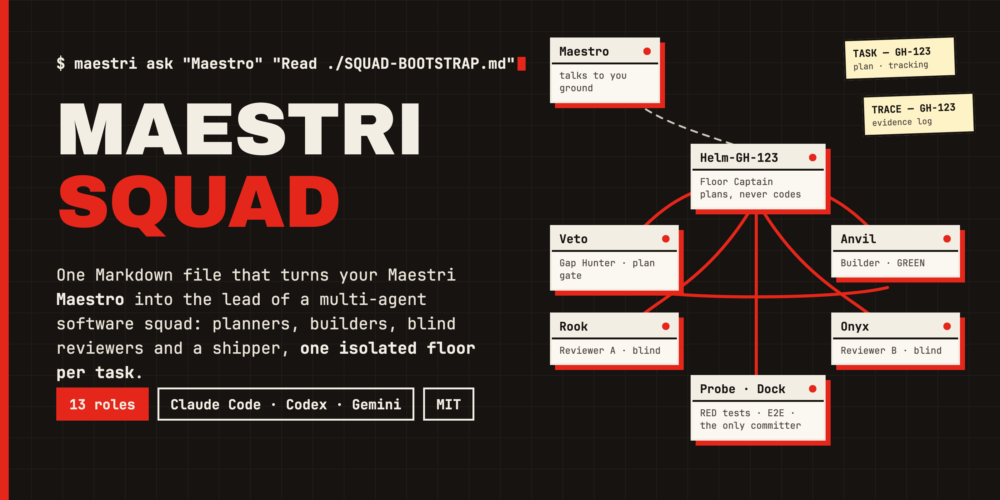
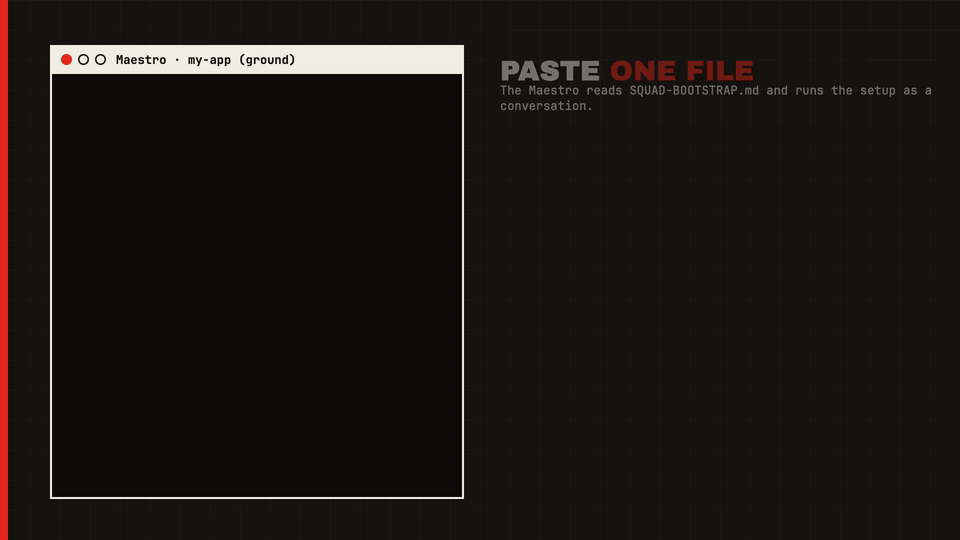
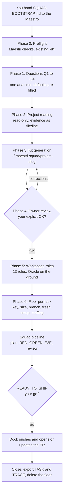
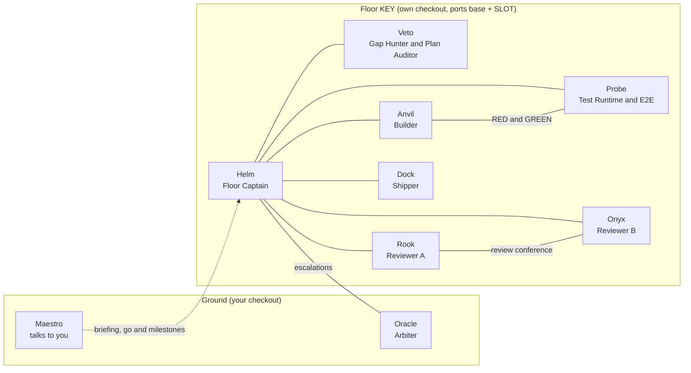

<p align="center">
  
</p>

<h1 align="center">Maestri Squad</h1>

<p align="center">
  <strong>One Markdown file that turns your <a href="https://www.themaestri.app/">Maestri</a> Maestro into the lead of a multi-agent software squad.</strong><br>
  It interviews you, reads your project, generates a kit, and staffs each task on its own isolated floor with separate planners, builders, blind reviewers and a shipper.
</p>

<p align="center">
  <a href="https://github.com/flaviorg/maestri-squad/actions/workflows/ci.yml"></a>
  <a href="LICENSE"></a>
  <a href="SQUAD-BOOTSTRAP.md"></a>
  <a href="CHANGELOG.md"></a>
</p>

English · [Português (Brasil)](README.pt-BR.md)

<p align="center">
  
</p>

The product is [`SQUAD-BOOTSTRAP.md`](SQUAD-BOOTSTRAP.md). You hand it to the Maestro (the lead agent of a Maestri
workspace; Maestri is the macOS spatial workspace for AI agents) and it does the rest, asking you only what it cannot
find out by reading the repo. There is nothing to install: the setup is a conversation, and its output is a folder
of plain files.

```text
Download the bootstrap with curl -fsSL https://raw.githubusercontent.com/flaviorg/maestri-squad/v1.0.0/SQUAD-BOOTSTRAP.md -o /tmp/SQUAD-BOOTSTRAP.md, read /tmp/SQUAD-BOOTSTRAP.md in full, and follow it for this project.
```

Paste that into your Maestro and answer four questions. Full steps in [Quick start](#quick-start).

**At a glance**

| | |
|---|---|
| **Separation of duties** | Helm plans, Veto approves, Probe writes failing tests, Anvil makes them pass, Rook and Onyx review blind, Dock is the only committer. |
| **One floor per task** | Each task gets its own git worktree, branch, dev-server port and device. Your checkout is never touched. |
| **Evidence, not vibes** | "Done" means a command and its output recorded in the TRACE note. Every gate is logged. |
| **Cross-family review** | Gates run on a different model family than planners and builders when you have two providers. |
| **Nothing leaves the machine** | Push, PR and tracker writes wait for your explicit go. Four safety lines no briefing can override. |
| **Sized to the task** | XS floors run four agents; S, M and L run seven at rising effort. Models are allocated by quota. |

<details>
<summary><b>Contents</b></summary>

- [Why](#why)
- [How it works](#how-it-works)
- [Requirements](#requirements)
- [Quick start](#quick-start)
- [What Maestro will ask you](#what-maestro-will-ask-you)
- [The generated kit](#the-generated-kit)
- [The squad](#the-squad)
- [Task sizes](#task-sizes)
- [Model allocation](#model-allocation)
- [The pipeline](#the-pipeline)
- [Supported stacks](#supported-stacks)
- [Safety defaults](#safety-defaults)
- [Updating](#updating)
- [Troubleshooting](#troubleshooting)
- [FAQ](#faq)
- [Contributing](#contributing)
- [License](#license)

</details>

## Why

A single agent that plans, codes, tests and approves its own work grades its own homework. It shares one context
(which degrades over a long task), one model's blind spots, and one working copy, so it does one task at a time,
inside the checkout you are also using.

A squad splits those duties and makes each hand-off a gate that needs evidence:

| One agent doing everything | A Maestri squad |
|---|---|
| Plans and approves its own plan | Helm plans; Veto, ideally from another model family, approves or rejects the plan |
| Writes the code and the tests that judge it | Probe writes failing tests first; Anvil makes them pass; neither can edit the other's work to get green |
| Reviews its own diff | Rook and Onyx review blind and independently, then confer; both must approve |
| Commits whenever it likes | Only Dock commits; push, PR and tracker writes wait for your go |
| Works in your checkout | Every task gets its own floor: a separate git checkout (worktree) on its branch, with its own dev-server port and device |
| Says "done" | "Done" means a command and its output recorded in the TRACE note |

The cost is more agents and more tokens. The kit sizes the squad to the task (XS floors run four agents) and
allocates models by quota, so the cost stays proportional.

## How it works

The Maestro follows the file phase by phase. Phases 0 to 5 happen once per project; Phase 6 and the operating loop
repeat for every task.



One floor at sizes S, M and L. The lines are the ropes (`maestri connect`) that `staff_floor.sh` creates; Helm is the
hub, and each lateral rope has one purpose. The TASK and TRACE notes are connected to every squad member.



Terms used in this README:

| Term | Meaning |
|---|---|
| Maestro | The Maestri agent in Maestro Mode. The only agent that talks to you. |
| Ground | The workspace's main checkout and canvas, where the Maestro and Oracle live. |
| Floor | One task's isolated space: its own git checkout on the task branch, its own agents, port and device. |
| Rope | A connection between two agents (or an agent and a note) on the canvas. |
| Kit | The generated folder of rules, role prompts, scripts and model map, outside your repo. |
| `KEY` | The floor's name: the ticket key (`PROJ-123`), `GH-123` for GitHub issue `#123`, or a short name. |
| Slot | A floor's number. Every port the floor publishes is its base + SLOT: the dev server's is `PORT_BASE + SLOT`. |
| TASK / TRACE | Two notes per floor: the plan and tracking (TASK), and the append-only evidence log (TRACE). |

## Requirements

| Requirement | Notes |
|---|---|
| Maestri 0.51.0+ on macOS | The project open as a Maestri workspace, with a terminal in Maestro Mode. |
| git with worktrees | The project must be a git repository; floors are separate checkouts of it. |
| At least one agent CLI | Claude Code, Codex or Gemini (or Antigravity), available as Maestri presets. |
| bash | The kit scripts run on the bash 3.2 that ships with macOS. |
| Optional: `gh` | When the Shipper opens pull requests on GitHub. |
| Optional: `shellcheck` | Only to contribute to this repo (`tools/check.sh`). |
| Optional: the stack's E2E tool | For example Maestro (maestro.dev) for mobile or Playwright for web; see [Supported stacks](#supported-stacks). |

Tested with Maestri 0.51.0, Claude Code 2.1.296 and codex-cli 0.161.0. A newer Maestri usually works: when a command
is rejected, the Maestro reads `maestri <command> --help` and adapts the flags, never the intent.

## Quick start

1. **Open your project in Maestri.** Open the repository's checkout as a Maestri workspace and start your lead agent
   in Maestro Mode on the ground. The bootstrap stops at Phase 0 if `maestri list` or `maestri preset list` fails.
2. **Paste this prompt into the Maestro:**

   ```text
   Download the bootstrap with curl -fsSL https://raw.githubusercontent.com/flaviorg/maestri-squad/v1.0.0/SQUAD-BOOTSTRAP.md -o /tmp/SQUAD-BOOTSTRAP.md, read /tmp/SQUAD-BOOTSTRAP.md in full, and follow it for this project.
   ```

3. **Answer, approve, and give it a task.** Answer the four questions (next section), review the one-screen kit
   summary, and reply OK. The Maestro creates the workspace roles, then asks for the first task: a ticket URL, an
   issue, or plain text.

The prompt pins the release tag (`v1.0.0`) and saves the file to disk: the Maestro extracts every kit file the
bootstrap carries (rules, role prompts, templates, scripts) from that file with one loop, never by retyping. To keep a
copy next to your project instead, or to work offline, use a local clone. From your project's root:

```bash
git clone --branch v1.0.0 https://github.com/flaviorg/maestri-squad.git ~/maestri-squad
cp ~/maestri-squad/SQUAD-BOOTSTRAP.md ./SQUAD-BOOTSTRAP.md
echo SQUAD-BOOTSTRAP.md >> .git/info/exclude
```

Then paste this prompt instead:

```text
Read ./SQUAD-BOOTSTRAP.md and follow it for this project.
```

The `.git/info/exclude` line keeps the copy out of your commits without touching `.gitignore`. An absolute path to
the clone (`~/maestri-squad/SQUAD-BOOTSTRAP.md`) works too.

## What Maestro will ask you

The Maestro asks one question at a time, in your language, with the value it detected pre-filled ("I found X; is that
right?"). Phase 2 then checks every answer against the repo and asks again, showing the evidence, when the repo
contradicts it.

| # | Question | Answer form | Example answer |
|---|---|---|---|
| Q1 | Area | Front / Mobile / Backend | `Mobile` |
| Q2 | Stack | one of the area's [supported stacks](#supported-stacks), or "Other" (uses the area's Generic section) | `Expo / React Native` |
| Q3 | Available agents and models | the presets from `maestri preset list` you want to use; the models of each, strongest first; a quota note per provider: plenty / limited / scarce (and, for limited or scarce, whether its roles may fall back to another provider); the strongest model overall and the best coding per cost | Claude Code: `claude-opus-5-5`, `claude-sonnet-5-5` (limited); Codex: `gpt-6.1-sol`, `gpt-6-astra` (plenty); strongest overall `claude-opus-5-5`, best coding per cost `gpt-6.1-sol`; Claude fallback to Codex: no |
| Q4 | Team policies | the items below, one at a time | see below |

Q4 items:

| Policy | Options | Example |
|---|---|---|
| Tracker | Jira / Linear / GitHub Issues / none; how each chosen preset's CLI reads a ticket (MCP servers are set up per CLI, and Helm may run on another CLI than the Maestro), or the Maestro pastes it; the key pattern as a regex | Jira through its MCP server in both CLIs, `PROJ-[0-9]+` |
| Base branch and branch pattern | the branch PRs target; the branch name pattern with `{key}` (the floor's KEY: the ticket key, or `GH-123` for issue `#123`) or `{num}` (its number only) and an optional `{slug}` | `develop`, `feature/{key}-{slug}` |
| Commit signing | yes / no; if yes, which key (its ID or file path), how the repo signs and the name of the env var or file holding a passphrase (never its value). With "no", commits pass `-c commit.gpgsign=false` when a git config signs anyway | yes, GPG key `ABCD1234`, passphrase in `$GPG_PASSPHRASE` |
| AI attribution in commits, PR bodies and tracker posts | allowed / forbidden (forbidden: no co-author trailer, no attribution line, no AI tool, model or agent name); whether the PR template has an AI-disclosure checkbox (always answered truthfully) | forbidden; the template has the checkbox |
| Language of commits, PRs and tracker posts | any; the default is English | English |
| Approvals | who approves pushes, merges and tracker writes; the default and minimum is you, through the Maestro | me |
| `CODEX_PRETRUST` | only asked when Q3 includes Codex: `1` lets the floor setup edit `~/.codex/config.toml` (after a backup); `0` means you approve Codex's dialogs yourself | `0` (the default) |

For a CLI without a known launch template (Gemini, Antigravity or another preset), the Maestro also asks once for
the exact command that starts it with a given model.

Anything the Maestro cannot resolve from the repo becomes a question, never a guess. Values it took from the stack
defaults that the repo neither confirms nor contradicts are listed as "Assumed" in the Phase 4 summary.

## The generated kit

The kit lives outside your repository, at `${MAESTRI_SQUAD_HOME:-$HOME/.maestri-squad}/<project-slug>`, where the
slug is the repo directory name in lower-kebab. Phase 0 shows it and asks for a better one when it is generic
(`repo`, `app`, `web`, ...) or already used by another project's kit. Set `MAESTRI_SQUAD_HOME` to keep kits
elsewhere; the path must not contain `"`, `\`, `$` or a backtick.

```text
~/.maestri-squad/<project-slug>/
├── KIT_VERSION              # the bootstrap version that generated the kit (1.0.0)
├── kit.env                  # project values sourced by the scripts
├── PROJECT_PROFILE.md       # every answer and finding, each with its evidence
├── RULES.md                 # the binding rules for every agent on every floor
├── RUNBOOK.md               # fresh setup, dev server per slot, build, E2E run, device notes
├── MODEL_MAP.tsv            # role and size → preset, model, effort, launch command, fallback
├── TASK_TEMPLATE.md         # template of each floor's TASK note
├── TRACE_TEMPLATE.md        # template of each floor's TRACE note
├── staff_floor.sh           # recruits, ropes and warms up a floor's squad (DRY_RUN=1: checks the kit only)
├── quota_watch.sh           # checks every agent still runs its staffed model
├── gpg-loopback.sh          # only when commits are signed with a passphrase: the signing wrapper
├── compose.floor.yaml       # only when the repo's compose file hardcodes a dependency port: per-floor ports
├── roles/                   # the 13 role prompts (floor-captain.txt, ...); a Backend without UI has no Loom or Prism
├── floor-snapshots/SLOTS.tsv  # which open floor holds which slot (and port, device)
└── floor-snapshots/<KEY>/   # per floor: STAFF.tsv, FLOOR-CARD.txt, HELM-BRIEFING.md, TASK-seed.md (free-text
                             #   tasks), fresh-setup.log, e2e/ evidence, TASK.md and TRACE.md exports, HANDOFF files
```

For a complete kit, see [`examples/expo-kit/`](examples/expo-kit/): a fictional kit showing what the bootstrap
generates for an Expo / React Native app.

`kit.env`:

| Field | Value |
|---|---|
| `PROJECT_SLUG` | the repo directory name, lower-kebab |
| `GROUND_PATH` | absolute path of your main checkout |
| `BASE_BRANCH` | the branch PRs target, for example `main` or `develop` |
| `BASE_REF` | where a new floor branch starts: `origin/<BASE_BRANCH>` when the repo has an `origin` remote, else `<BASE_BRANCH>` |
| `BRANCH_PATTERN` | the branch name pattern with `{key}` (or `{num}`, the key's number only) and an optional `{slug}`, for example `feature/{key}-{slug}`, `feature/{key}` or `feat/{num}-{slug}` |
| `PORT_BASE` | the dev-server port; a floor uses `PORT_BASE + SLOT` (every other port it publishes is its base + SLOT, listed in `RUNBOOK.md`) |
| `KIT_VERSION` | `1.0.0` |
| `CODEX_PRETRUST` | `0` (default) or `1`, from Q4 |

`MODEL_MAP.tsv` is tab-separated, one row per role and size, plus one row per on-demand role (size `*`) and a
`Fallback` row for any fallback model no other row runs:

| Column | Value |
|---|---|
| `role`, `size` | codename (or `Fallback`); `XS`, `S`, `M`, `L` or `*` |
| `preset` | the exact name from `maestri preset list` |
| `model`, `effort` | from the [model allocation](#model-allocation) |
| `launch_template` | the command that starts the CLI, with `{model}`, `{effort}`, `{name}`, `{floor_path}`, `{kit}` |
| `footer_regex` | how the CLI's status bar shows the model, for example `Opus 5\.5` |
| `fallback_model` | the next-best model of the same preset, or another provider's model when you allow it in Q3 |

Example rows:

```text
role	size	preset	model	effort	launch_template	footer_regex	fallback_model
Helm	S	Codex	gpt-6.1-sol	high	codex -m {model} -c model_reasoning_effort={effort} -c check_for_update_on_startup=false --add-dir {kit}	GPT-6\.1-Sol	gpt-6-astra
Fallback	*	Codex	gpt-6-astra	high	codex -m {model} -c model_reasoning_effort={effort} -c check_for_update_on_startup=false --add-dir {kit}	GPT-6-Astra	gpt-6-astra
```

You review the whole kit in Phase 4 before anything is wired into the workspace.

## The squad

Thirteen roles. On a floor each agent is named `<Codename>-<KEY>` (for example `Helm-PROJ-123`); Oracle and the
Maestro live on the ground.

| Codename | Role name | Job | Default slot | On |
|---|---|---|---|---|
| Helm | Floor Captain | Reads the ticket, plans, drives the floor and reports milestones to the Maestro. Never writes code. | PLANNER | every floor |
| Veto | Gap Hunter & Plan Auditor | Hunts product gaps against the real code, approves or rejects the plan, audits the TRACE. | GATE | S, M, L |
| Anvil | Builder | Implements the approved steps once failing tests exist; resolves sync conflicts. Never commits. | BUILDER | every floor |
| Probe | Test Runtime & E2E | Runs the app on the floor's port and device, records the baseline, writes RED tests, re-runs gates, runs E2E. | BUILDER | S, M, L; XS on demand |
| Rook | Reviewer A | Blind adversarial code review; leads the conference with Onyx. Read-only. | REVIEWER_A | S, M, L |
| Onyx | Reviewer B | Blind independent review: platforms, performance, accessibility, correctness. Read-only. | GATE | S, M, L |
| Onyx | Solo Gate | On XS, holds every gate alone: gap check, plan audit, review, TRACE audit. | GATE | XS |
| Dock | Shipper | The only committer. Pushes and opens or updates the PR only after your go. | SHIPPER | every floor |
| Oracle | Arbiter | Rules on reviewer deadlocks, plan disputes and architecture questions. | ARBITER | once per workspace, on the ground |
| Aegis | Security Auditor | Audits plan and diff for auth, tokens, PII, injection and similar; CRITICAL or HIGH blocks shipping. | GATE | on demand |
| Loom | UI Builder | Builds the UI steps assigned to it with the design system's components and tokens. | BUILDER | on demand |
| Prism | UX Advisor | Evidence-based UX, accessibility and performance recommendations. | REVIEWER_A | on demand |
| Broom | Sweep Engineer | Clears follow-up and SWEEP items, one small test-first diff at a time. | BUILDER | on demand |

## Task sizes

For each task the Maestro states a size with a one- or two-sentence reason, plus a risk (LOW, MEDIUM or HIGH). You
can correct both.

| Size | Use for | Squad |
|---|---|---|
| XS | Maintenance only: base sync, test fix, version or dependency bump, CI tweak. No new user-facing behavior. | Helm, Anvil, Onyx (Solo Gate), Dock; Probe joins when a build, a device or E2E is needed |
| S | A small change in one area | Helm, Veto, Anvil, Probe, Rook, Onyx, Dock |
| M | A change across several modules, or with persisted data | the same seven, at higher effort |
| L | A cross-cutting change, or several risk triggers | the same seven, at the highest effort |

The effort each role runs at per size is in [Model allocation](#model-allocation).

When the Maestro escalates:

- A task that touches one of the stack's **risk triggers** (for example native module bumps, migrations, auth) is
  never XS and weighs toward M or L.
- Auth, secrets, payments or data exposure: the Maestro also calls **Aegis**.
- On XS, Onyx answers **NOT_XS** when the task turns out to add behavior, UI, persisted data, auth, or a native or
  infrastructure change. Helm reports PLAN_CHANGE_REQUIRED and the Maestro re-staffs the floor as S: it adds Veto,
  Probe and Rook with `ONLY="Veto Probe Rook" $KIT/staff_floor.sh <KEY> S <FLOOR_PATH> <SLOT>` (without Probe if it
  already joined), turns Onyx into Reviewer B in place at its S effort (`maestri recruit ... --replace`), updates
  `STAFF.tsv` and sends the new floor cards (RULES §XS).
- An XS floor that needs a build or E2E gets Probe added in place:
  `ONLY="Probe" $KIT/staff_floor.sh <KEY> XS <FLOOR_PATH> <SLOT>`.

## Model allocation

Roles map to capability slots, not to model names. A family is the vendor behind a preset (Claude Code → Anthropic,
Codex → OpenAI, Gemini or Antigravity → Google). Independence comes from putting the gates on a different family
than the planner and builders.

| Slot | Roles | Allocation rule |
|---|---|---|
| PLANNER | Helm | strong model with the most quota (one provider: the best coding-per-cost model) |
| BUILDER | Anvil, Probe, Loom, Broom | best coding-per-cost model |
| GATE | Veto, Onyx (Solo Gate on XS), Aegis | strongest model, different family from PLANNER and BUILDER when available |
| REVIEWER_A | Rook, Prism | strong model, different family from Onyx when available |
| SHIPPER | Dock | cheapest reliable model |
| ARBITER | Oracle | strongest model available |

Example: Codex (plenty) and Claude Code (limited) → PLANNER and BUILDER on Codex, GATE on Claude's strongest model,
REVIEWER_A on Codex's strongest, SHIPPER on the cheapest reliable model, ARBITER on the strongest overall.

Effort per role and size (`—` = not on that floor):

| Role | Slot | XS | S | M | L |
|---|---|---|---|---|---|
| Helm | PLANNER | high | high | high | xhigh |
| Veto | GATE | — | high | xhigh | xhigh |
| Anvil | BUILDER | medium | medium | high | xhigh |
| Probe | BUILDER | medium | medium | high | high |
| Rook | REVIEWER_A | — | high | high | xhigh |
| Onyx | GATE | high | high | xhigh | xhigh |
| Dock | SHIPPER | medium | medium | medium | medium |

On-demand roles run at one effort for every size: Oracle, Aegis and Prism `high`; Loom and Broom `medium`.

Degenerate cases:

| Case | What happens |
|---|---|
| One provider | Every slot uses it: PLANNER and REVIEWER_A take the best coding-per-cost model, GATE and ARBITER the strongest. Cross-family independence is lost, and Phase 4 shows a warning. The reviewers stay separate agents with a blind first step. |
| One model | Same as one provider, with the same warning. Effort levels still differ per size. |
| Scarce quota on a provider | That provider takes only the GATE slot; everything else moves to the other provider. Its agents get one consolidated ask per milestone. |

The warning, shown verbatim in the Phase 4 summary when it applies:

> WARNING: no cross-family review independence. <Rook and Onyx | the gate and the builders> run on the same model
> family (<family>), so they share its blind spots. They stay separate agents with a blind step 1. Add a second
> provider in Q3 to restore independence.

"Cheapest" (SHIPPER) means the least pressure on a limited quota first, then the lowest price. An effort level a
model may not accept is listed as assumed in the Phase 4 summary.

Each row also names a `fallback_model`. When an agent silently drops to another model or hits a usage limit,
`quota_watch.sh` flags it and the Maestro swaps it in place to that fallback (see
[Troubleshooting](#troubleshooting)). While another family exists, a GATE fallback never uses the PLANNER/BUILDER
family, and a REVIEWER_A fallback never uses Onyx's (GATE) family; when that cannot hold, Phase 4 shows the warning
with "on fallback".

## The pipeline

Every stage is logged in the TRACE note with its evidence. Helm reports each milestone to the Maestro, who runs
`quota_watch.sh` and relays to you only what needs you.

| # | Stage | Owner | Gate to move on |
|---|---|---|---|
| 0 | Fresh setup and BOOT | Maestro, Helm | the stack's fresh-setup recipe ran on the floor (`FRESH_SETUP ok` is the first TRACE row); TASK and TRACE notes created; Helm replies BOOT_OK |
| 1 | INTAKE | Helm | ticket pasted verbatim into TASK; acceptance criteria normalized as AC-1..n |
| 2 | GAPS | Veto (Onyx on XS) | every gap recorded with evidence; BLOCKER gaps become questions relayed to you |
| 3 | PLAN | Helm, audited by Veto | PLAN_APPROVED; only that unlocks work; two rejections go to Oracle |
| 4 | ENV and BASELINE | Probe | the app runs on this floor's port and device; the full gates' baseline is recorded |
| 5 | RED | Probe | a failing test per AC that fails because the target is absent, pasted into the TRACE |
| 6 | GREEN | Anvil (Loom for assigned UI) | minimal code; Probe re-runs every gate itself |
| 7 | E2E | Probe | one scenario per user-facing AC, the tool's machine-readable report plus artifacts; upgrade-in-place check for persisted-data changes |
| 8 | SYNC BASE | Dock (Anvil resolves conflicts) | local checkpoint commit, base branch merged into the floor branch, gates and E2E re-run |
| 9 | REVIEW | Rook and Onyx, Veto audits the TRACE | blind step 1, a conference of at most 3 exchanges, then both APPROVE and TRACE_AUDIT_OK; a deadlock or 3 review cycles go to Oracle |
| 10 | SHIP | Dock | Dock commits and reports READY_TO_SHIP; the Maestro checks the TRACE and shows you the exact push and PR; nothing leaves the machine before your go |
| 11 | DELIVERY and WORKBENCH | Helm | delivery report in TASK; later owner requests run reproduce → RED → fix → E2E → delta review → Dock |

Closing a floor is your call. The Maestro exports the TASK and TRACE notes to `floor-snapshots/<KEY>/`, deletes the
floor with `maestri floor delete "<KEY>" --keep-branch` (its own checkout only), and purges build output and caches
from the snapshot folder. It never cleans your ground checkout or another floor.

## Supported stacks

Each stack section gives the Maestro detection hints, gates, the E2E tool, dev-server ports, generated directories, a
fresh-setup recipe, risk triggers and conventions worth a rule. Phase 2 overrides every value with what your repo
shows.

| Stack | Area | Status | Default E2E | Default `PORT_BASE` |
|---|---|---|---|---|
| Expo / React Native | Mobile | battle-tested | Maestro (maestro.dev) | 8081 |
| Flutter | Mobile | starter | Maestro, or `integration_test` | none for device builds; 8100 for web |
| React / Next.js | Front | starter | Playwright | 3000 |
| Node (Nest / Express) | Backend | starter | supertest contract tests | 3000 |
| Python (FastAPI / Django) | Backend | starter | pytest with httpx or the Django test client | 8000 |
| Go | Backend | starter | `go test` with httptest and testcontainers | 8080 |
| Generic Front | Front | starter | Playwright, or the repo's browser tool | 3000 |
| Generic Mobile | Mobile | starter | Maestro, or the repo's XCUITest, Espresso or Detox | 8081 |
| Generic Backend | Backend | starter | HTTP contract tests in the repo's runner | 8080 |

- **battle-tested**: run end to end by a real squad on a production app.
- **starter**: written from the stack's standard tooling, not yet run end to end by a squad. The Maestro verifies
  every command against your repo in Phase 2, and the kit summary shows the stack as `starter`.
- **Other**: answer "Other" in Q2 and the Maestro uses the Generic section of your area.

## Safety defaults

Always on. No briefing, owner shortcut or tool default overrides these four lines:

- Agents never merge, force-push, run `git reset --hard` or `git clean -fd`.
- Only the Shipper commits.
- Every external write needs the human's go through the Maestro.
- Secrets are passed by file reference only.

"External write" means a push, opening or editing a PR, closing PRs or issues, tracker comments, edits and
transitions, or any message posted outside the canvas. Also:

- Nothing is written inside your repository during setup (Phases 0 to 5); the kit lives in its own folder.
- Agents never land work on a shared branch. The one allowed merge is the base branch into the floor branch (SYNC
  BASE), done by Dock as a local commit.
- The kit never edits your Codex config unless you set `CODEX_PRETRUST=1`, and then only after a backup.
- Your ground checkout and other floors are never deleted, reset or cleaned by the squad.
- Secret values live in files outside the repo; agents use their names and paths, never echo the values.

These are instructed rules the Maestro checks, not a sandbox: the agents are told to follow them, and the Maestro
verifies their work at every gate, but nothing in the kit technically prevents an agent from breaking one.
Keep branch protection on your shared branches (required reviews, no force-push), and review the agent CLIs'
permission modes in `MODEL_MAP.tsv` (the `launch_template` column, for example Claude Code's
`--permission-mode auto`) before you staff a floor.

To change a Q4 policy (tracker, signing, attribution, approvals), run the bootstrap again, choose **update**, and
state the new answer; the new value shows up in the Phase 4 summary for your OK, and Phase 5 replaces any workspace
role whose text changed, again on your OK. `CODEX_PRETRUST` is a Q4 answer too: to change it for good, change the
answer (correct it in the Phase 4 summary during an update, or in `PROJECT_PROFILE.md`). You can also flip it in
`kit.env`, which `staff_floor.sh` reads on every run, but a direct `kit.env` edit lasts only until the next update:
the update regenerates `kit.env` from the answer kept in `PROJECT_PROFILE.md`. Policies can make the rules stricter
but never relax the four lines above.

## Updating

The first line of `SQUAD-BOOTSTRAP.md` carries the version (`<!-- maestri-squad v1.0.0 -->`), and the kit records the
version that generated it in `KIT_VERSION`. Changes are listed in [`CHANGELOG.md`](CHANGELOG.md).

To update, hand the Maestro the new file with the same prompt, its tag changed to the new version. Phase 0 finds the
existing kit, shows both versions, and offers three choices:

| Choice | Effect |
|---|---|
| update | Regenerates every kit file from the new version, keeping your answers and evidence in `PROJECT_PROFILE.md` and everything under `floor-snapshots/`. Only missing answers are asked; Phase 4 shows what changed. |
| keep | Uses the kit as it is; creates any missing workspace role; opens the next floor. |
| start over | Moves the old kit aside to `<kit>.bak-<YYYYMMDD>` (never deleted) and starts from Phase 1. |

Hand edits to generated kit files are overwritten by an update, `kit.env` included. Give lasting overrides to the
Maestro instead, so they are recorded in `PROJECT_PROFILE.md` and `RULES.md` `§Project`; change `CODEX_PRETRUST`
through its Q4 answer (see [Safety defaults](#safety-defaults)).

## Troubleshooting

**An agent answered and then stopped working.** The message it received ended with a request for an acknowledgement
only, so its turn ended. Send the next action instead, and confirm it is working:

```bash
maestri ask "Anvil-PROJ-123" "Continue with step 3 now; report to Helm when done."
maestri check "Anvil-PROJ-123"
```

**`maestri floor create` or `maestri floor delete` timed out.** Both can time out and still complete. Run
`maestri floor list` before repeating anything: a repeated create can make a second floor, and a repeated delete can
hit the wrong one.

**A Codex agent is stuck on a dialog.** `staff_floor.sh` skips Codex's update menu by itself. With the default
`CODEX_PRETRUST=0`, a "hook needs review" dialog is left for you: the script prints
`WARM <agent> waiting: a hook needs review`; approve the dialog in that agent's terminal, or change the
`CODEX_PRETRUST` answer to `1` for future floors (see [Safety defaults](#safety-defaults)). If the last line of
`staff_floor.sh` shows `warm_fail=1`, run `maestri check` on each agent it names as NOT CONFIRMED and clear what the
terminal shows before briefing it.

**Check a kit without staffing anything.** A dry run checks `kit.env`, every `MODEL_MAP.tsv` row a size needs, each
fallback and the on-demand rows, then prints the plan (agent, preset, model, effort, launch command). It makes no
maestri call and writes nothing; the Maestro runs it for every size in Phase 3:

```bash
KIT="${MAESTRI_SQUAD_HOME:-$HOME/.maestri-squad}/my-project"
DRY_RUN=1 "$KIT/staff_floor.sh" CHECK S "$PWD" 1
```

**An agent silently fell back to another model.** Agent CLIs can switch models on a quota limit or an outage while
the agent keeps logging the staffed model. The terminal status bar is the truth. The Maestro runs this at every
milestone, and you can too:

```bash
KIT="${MAESTRI_SQUAD_HOME:-$HOME/.maestri-squad}/my-project"
"$KIT/quota_watch.sh" PROJ-123
```

It prints `AGENT STAFFED STATUS FOOTER` per agent and exits 0 when every row is `OK`, 1 otherwise, and 2 when the
floor's `STAFF.tsv` or the kit's `MODEL_MAP.tsv` is missing.

| Status | Meaning | Action |
|---|---|---|
| `OK` | the footer shows the staffed model, no limit warning | none |
| `MODEL?` | the footer does not show the staffed model | swap to the row's `fallback_model`; if the right model is on screen, fix `footer_regex` in `MODEL_MAP.tsv` |
| `ALERT` | a usage-limit phrase in the footer | swap to the row's `fallback_model` |
| `GONE` | `maestri check` failed for that agent (dead terminal) | swap to the row's `fallback_model` |

The swap keeps the agent's name, role and ropes:
`maestri recruit "<Agent>-<KEY>" --preset <preset> --command "<launch command with the fallback model>" --replace "<Agent>-<KEY>"`,
followed by its floor card and a re-brief.

**The Maestro stops at Phase 0 with "Maestri in Maestro Mode is required".** Open the project as a Maestri workspace,
make that terminal the Maestro, and hand it the file again.

**The Maestro stops at Phase 0 because the workspace roles belong to another project.** Every role prompt starts with
`Kit: <project-slug> (maestri-squad)`. Roles with the squad's names but another kit line were written for another
project, and the Maestro never reuses them silently. The same goes for an `Oracle` on the canvas when the `Arbiter`
role is missing or not this kit's. Open this repo in its own Maestri workspace (recommended), or tell the Maestro to
replace those roles in this one (it then re-recruits Oracle in place).

**The Maestro will not open a floor because a tool is missing.** Phase 2 marks every tool the gates, fresh setup, E2E
and shipping need as installed (with its version) or `MISSING`, and the Phase 4 summary lists the missing ones with an
install hint. Install them; Phase 6 checks again before it opens a floor.

## FAQ

**Does it write to my repository?**
Not during setup. Afterwards, work happens on floors, each a separate checkout on its own branch. Only Dock commits,
to the floor branch, and nothing is pushed without your go.

**Do I need two AI providers?**
No. One provider or even one model works; you lose cross-family review independence, and the Phase 4 summary says so.

**Can I run several floors at once?**
Yes. Each floor has its own slot, port, device and squad. Oracle is shared across floors.

**Is "Maestro" the mobile E2E tool?**
No. In this README, the Maestro is Maestri's lead agent. The mobile E2E tool of the same name is written as
"Maestro (maestro.dev)".

**My stack is not listed.**
Answer "Other" in Q2. The Generic section of your area is used, and Phase 2 fills the gates and E2E from your CI and
manifests. A dedicated stack section is a welcome contribution.

**Where does the kit live, and can I move it?**
At `${MAESTRI_SQUAD_HOME:-$HOME/.maestri-squad}/<project-slug>`. Set `MAESTRI_SQUAD_HOME` before running the
bootstrap to put kits elsewhere.

**Can the Maestro decide product questions for me?**
No. Low-risk ambiguities are decided and logged by Helm; product decisions and BLOCKER gaps come to you, quoted from
the floor, one question at a time.

## Contributing

`SQUAD-BOOTSTRAP.md` is generated. Edit the sources in `src/`, then rebuild:

```bash
tools/build.sh
```

| Path | Content |
|---|---|
| `src/main/` | the header and Phases 0 to 6 |
| `src/appendix/` | Appendices A to G: rules, roles, stacks, scripts, operating loop, lessons, templates |
| `src/scripts/` | `staff_floor.sh` and `quota_watch.sh`, embedded verbatim by `@@include` lines |
| `src/order.txt` | the order in which `tools/build.sh` concatenates the sources |
| `tests/` | bash test suites (`tests/lib.sh` helpers) |
| `examples/` | `expo-kit/`, a fictional generated kit; its scripts must match `src/scripts/` (gate `examples_scripts_in_sync`) |
| `tools/` | `build.sh`, `check.sh`, `extract.sh`, `denylist.txt` |

### Adding a stack

Add a `### <Stack name>` section to `src/appendix/C-stacks.md`, before the Generic sections, with these nine `####`
fields in this order:

1. `Status`: `starter`, followed by the line "Written from the stack's standard tooling; not yet run end to end by a
   squad — verify every command in Phase 2." Only a stack run end to end by a real squad becomes `battle-tested`.
2. `Detection hints`
3. `Gates`
4. `E2E`
5. `Dev server and ports` (with a default `PORT_BASE`)
6. `Generated directories`
7. `Fresh setup`
8. `Risk triggers`
9. `Conventions worth a rule`

Then add the stack name to `STACK_NAMES` in `tests/test_content.sh`, add a row to the stacks table in both READMEs,
and rebuild.

### Running the checks

```bash
tools/check.sh                 # every gate
tools/check.sh --fast          # skip shellcheck
tools/check.sh --only tests    # one gate: sanitize, shellcheck, tests, build_fresh, embedded_scripts, examples_scripts_in_sync
```

The scripts and tests target the bash 3.2 that ships with macOS (no `mapfile`, no associative arrays) and use
`set -euo pipefail`. CI runs `tools/check.sh` on Ubuntu and macOS.

### The sanitize lists

The `sanitize` gate greps every tracked file (`git ls-files`; untracked files never trip it) for the patterns in two
lists, both one POSIX extended regex per line, with `#` comments and blank lines ignored:

- `tools/denylist.txt`, public and generic: personal home paths, private key headers, common secret token prefixes.
- A private list, `.git/info/denylist` in your checkout (or the file named by `SANITIZE_DENYLIST_PRIVATE`). Add your
  own private terms there (your employer's name, your ticket prefix, your username) and never commit them. The gate
  skips it when it does not exist, as in CI.

### Pull request checklist

- [ ] Changes are in `src/`, and `SQUAD-BOOTSTRAP.md` is rebuilt with `tools/build.sh` (the `build_fresh` gate fails
      on a stale file).
- [ ] `tools/check.sh` is green.
- [ ] No project-specific names, personal paths or ticket keys anywhere (the `sanitize` gate checks
      `tools/denylist.txt` and your private list).
- [ ] New behavior has a test; scripts stay bash 3.2 compatible.
- [ ] Both READMEs are updated when user-facing behavior changes, and `CHANGELOG.md` notes it.
- [ ] Commits follow Conventional Commits.

## License

[MIT](LICENSE) © 2026 Flavio Gouveia

### Credits

- [Maestri](https://www.themaestri.app/), the infinite canvas for orchestrating AI agents, by its authors. This project is an independent kit for it and is not affiliated with Maestri.
- Built by [Flavio Gouveia](https://oflavio.dev), a senior frontend and mobile engineer who shows how a real developer uses Claude and Codex at work · [Instagram @oflavio.dev](https://www.instagram.com/oflavio.dev/) · [GitHub](https://github.com/flaviorg)
