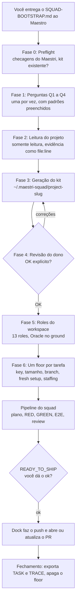
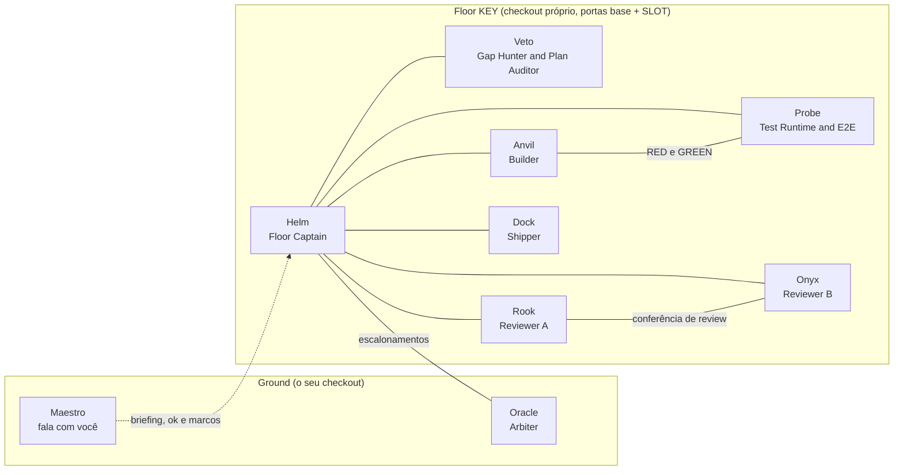

# Maestri Squad

Um único arquivo Markdown que transforma o Maestro do Maestri no líder de um squad de software multiagente: ele
entrevista você, lê o seu projeto, gera um kit e coloca cada tarefa em um floor isolado, com planejador, builders,
revisores e um shipper separados.

[](https://github.com/flaviorg/maestri-squad/actions/workflows/ci.yml)
[](LICENSE)
[](SQUAD-BOOTSTRAP.md)

[English](README.md) · Português (Brasil)

O produto é o [`SQUAD-BOOTSTRAP.md`](SQUAD-BOOTSTRAP.md). Você entrega o arquivo ao Maestro (o agente líder de um
workspace do Maestri; o Maestri é o workspace espacial para agentes de IA no macOS) e ele faz o resto, perguntando só o
que não consegue descobrir lendo o repositório. Não há nada para instalar: o setup é uma conversa, e o resultado é uma
pasta de arquivos de texto.

## Por quê

Um agente sozinho que planeja, codifica, testa e aprova o próprio trabalho corrige a própria prova. Ele tem um único
contexto (que se degrada ao longo de uma tarefa longa), os pontos cegos de um único modelo e uma única cópia de
trabalho; então faz uma tarefa por vez, dentro do mesmo checkout que você está usando.

Um squad divide essas funções e transforma cada passagem de bastão em um gate que exige evidência:

| Um agente fazendo tudo | Um squad no Maestri |
|---|---|
| Planeja e aprova o próprio plano | Helm planeja; Veto, de preferência de outra família de modelos, aprova ou rejeita o plano |
| Escreve o código e os testes que o julgam | Probe escreve primeiro os testes que falham; Anvil os faz passar; nenhum pode mexer no trabalho do outro para ficar verde |
| Revisa o próprio diff | Rook e Onyx revisam às cegas e de forma independente, depois conferenciam; os dois precisam aprovar |
| Faz commit quando quer | Só o Dock faz commit; push, PR e escritas no tracker esperam o seu ok |
| Trabalha no seu checkout | Cada tarefa ganha o próprio floor: um checkout git separado (worktree) na sua branch, com porta de dev server e dispositivo próprios |
| Diz "pronto" | "Pronto" significa um comando e a saída dele registrados na nota TRACE |

O custo é ter mais agentes e gastar mais tokens. O kit dimensiona o squad conforme a tarefa (floors XS rodam quatro
agentes) e distribui os modelos de acordo com a cota, então o custo fica proporcional.

## Como funciona

O Maestro segue o arquivo fase a fase. As Fases 0 a 5 acontecem uma vez por projeto; a Fase 6 e o loop de operação se
repetem a cada tarefa.



Um floor nos tamanhos S, M e L. As linhas são as ropes (`maestri connect`) que o `staff_floor.sh` cria; o Helm é o
centro, e cada rope lateral tem um único propósito. As notas TASK e TRACE ficam conectadas a todos os membros do
squad.



Termos usados neste README:

| Termo | Significado |
|---|---|
| Maestro | O agente do Maestri em Maestro Mode. O único agente que fala com você. |
| Ground | O checkout principal e o canvas do workspace, onde vivem o Maestro e o Oracle. |
| Floor | O espaço isolado de uma tarefa: checkout git próprio na branch da tarefa, agentes, porta e dispositivo próprios. |
| Rope | Uma conexão entre dois agentes (ou entre um agente e uma nota) no canvas. |
| Kit | A pasta gerada com regras, prompts das roles, scripts e o mapa de modelos, fora do seu repositório. |
| `KEY` | O nome do floor: a key do ticket (`PROJ-123`), `GH-123` para a issue `#123` do GitHub, ou um nome curto. |
| Slot | O número de um floor. Cada porta que o floor publica é a sua base + SLOT: a do dev server é `PORT_BASE + SLOT`. |
| TASK / TRACE | Duas notas por floor: o plano e o acompanhamento (TASK) e o log de evidências, só de acréscimo (TRACE). |

## Requisitos

| Requisito | Observações |
|---|---|
| Maestri 0.51.0+ no macOS | O projeto aberto como workspace do Maestri, com um terminal em Maestro Mode. |
| git com worktrees | O projeto precisa ser um repositório git; os floors são checkouts separados dele. |
| Pelo menos uma CLI de agente | Claude Code, Codex ou Gemini (ou Antigravity), disponíveis como presets do Maestri. |
| bash | Os scripts do kit rodam no bash 3.2 que vem com o macOS. |
| Opcional: `gh` | Quando o Shipper abre pull requests no GitHub. |
| Opcional: `shellcheck` | Só para contribuir com este repositório (`tools/check.sh`). |
| Opcional: a ferramenta de E2E da stack | Por exemplo Maestro (maestro.dev) para mobile ou Playwright para web; veja [Stacks suportadas](#stacks-suportadas). |

Testado com Maestri 0.51.0, Claude Code 2.1.296 e codex-cli 0.161.0. Um Maestri mais novo costuma funcionar: quando um
comando é rejeitado, o Maestro lê `maestri <command> --help` e adapta as flags, nunca a intenção.

## Início rápido

1. **Abra o seu projeto no Maestri.** Abra o checkout do repositório como workspace do Maestri e inicie o seu agente
   líder em Maestro Mode no ground. O bootstrap para na Fase 0 se `maestri list` ou `maestri preset list` falhar.
2. **Cole este prompt no Maestro:**

   ```text
   Download the bootstrap with curl -fsSL https://raw.githubusercontent.com/flaviorg/maestri-squad/v1.0.0/SQUAD-BOOTSTRAP.md -o /tmp/SQUAD-BOOTSTRAP.md, read /tmp/SQUAD-BOOTSTRAP.md in full, and follow it for this project.
   ```

3. **Responda, aprove e passe uma tarefa.** Responda às quatro perguntas (próxima seção), revise o resumo do kit em
   uma tela e responda OK. O Maestro cria as roles do workspace e pede a primeira tarefa: a URL de um ticket, uma
   issue ou um texto livre.

O prompt pode ficar em inglês: o Maestro conversa com você no seu idioma.

O prompt fixa a tag da release (`v1.0.0`) e salva o arquivo em disco: o Maestro extrai cada arquivo do kit que o
bootstrap carrega (regras, prompts das roles, templates, scripts) desse arquivo com um único loop, sem redigitar nada.
Para manter uma cópia ao lado do projeto, ou para trabalhar offline, use um clone local. Na raiz do seu projeto:

```bash
git clone --branch v1.0.0 https://github.com/flaviorg/maestri-squad.git ~/maestri-squad
cp ~/maestri-squad/SQUAD-BOOTSTRAP.md ./SQUAD-BOOTSTRAP.md
echo SQUAD-BOOTSTRAP.md >> .git/info/exclude
```

Depois cole este prompt no lugar do anterior:

```text
Read ./SQUAD-BOOTSTRAP.md and follow it for this project.
```

A linha do `.git/info/exclude` mantém a cópia fora dos seus commits sem mexer no `.gitignore`. Um caminho absoluto
para o clone (`~/maestri-squad/SQUAD-BOOTSTRAP.md`) também funciona.

## O que o Maestro vai perguntar

O Maestro faz uma pergunta por vez, no seu idioma, com o valor que detectou já preenchido ("Encontrei X; está
certo?"). Depois, a Fase 2 confere cada resposta contra o repositório e pergunta de novo, mostrando a evidência,
quando o repositório a contradiz.

| # | Pergunta | Forma da resposta | Exemplo de resposta |
|---|---|---|---|
| Q1 | Área | Front / Mobile / Backend | `Mobile` |
| Q2 | Stack | uma das [stacks suportadas](#stacks-suportadas) da área, ou "Other" (usa a seção Generic da área) | `Expo / React Native` |
| Q3 | Agentes e modelos disponíveis | os presets de `maestri preset list` que você quer usar; os modelos de cada um, do mais forte para o mais fraco; uma nota de cota por provedor: plenty / limited / scarce (e, para limited ou scarce, se as roles dele podem cair para um modelo de outro provedor); o modelo mais forte no geral e o de melhor custo-benefício para código | Claude Code: `claude-opus-5-5`, `claude-sonnet-5-5` (limited); Codex: `gpt-6.1-sol`, `gpt-6-astra` (plenty); mais forte no geral `claude-opus-5-5`, melhor custo-benefício para código `gpt-6.1-sol`; fallback do Claude para o Codex: não |
| Q4 | Políticas do time | os itens abaixo, um por vez | veja abaixo |

Itens da Q4:

| Política | Opções | Exemplo |
|---|---|---|
| Tracker | Jira / Linear / GitHub Issues / nenhum; como a CLI de cada preset escolhido lê um ticket (servidores MCP são configurados por CLI, e o Helm pode rodar numa CLI diferente da do Maestro), ou o Maestro cola o ticket; o padrão da key como regex | Jira pelo servidor MCP nas duas CLIs, `PROJ-[0-9]+` |
| Branch base e padrão de branch | a branch alvo dos PRs; o padrão de nome de branch com `{key}` (a KEY do floor: a key do ticket, ou `GH-123` para a issue `#123`) ou `{num}` (só o número) e um `{slug}` opcional | `develop`, `feature/{key}-{slug}` |
| Assinatura de commits | sim / não; se sim, qual chave (o ID ou o caminho do arquivo), como o repositório assina e o nome da variável de ambiente ou do arquivo que guarda a passphrase (nunca o valor). Com "não", os commits passam `-c commit.gpgsign=false` quando uma config do git assina mesmo assim | sim, chave GPG `ABCD1234`, passphrase em `$GPG_PASSPHRASE` |
| Atribuição de IA em commits, corpos de PR e posts no tracker | permitida / proibida (proibida: sem trailer de coautoria, sem linha de atribuição, sem nome de ferramenta, modelo ou agente de IA); se o template de PR tem um checkbox de uso de IA (sempre respondido com a verdade) | proibida; o template tem o checkbox |
| Idioma de commits, PRs e posts no tracker | qualquer um; o padrão é inglês | inglês |
| Aprovações | quem aprova pushes, merges e escritas no tracker; o padrão, e o mínimo, é você, por meio do Maestro | eu |
| `CODEX_PRETRUST` | perguntado só quando a Q3 inclui o Codex: `1` permite que o setup do floor edite `~/.codex/config.toml` (depois de um backup); `0` significa que você mesmo aprova os diálogos do Codex | `0` (o padrão) |

Para uma CLI sem template de inicialização conhecido (Gemini, Antigravity ou outro preset), o Maestro também pergunta
uma vez o comando exato que a inicia com um dado modelo.

Tudo o que o Maestro não consegue resolver pelo repositório vira pergunta, nunca palpite. Valores tirados dos padrões
da stack que o repositório nem confirma nem contradiz aparecem como "Assumed" no resumo da Fase 4.

## O kit gerado

O kit fica fora do seu repositório, em `${MAESTRI_SQUAD_HOME:-$HOME/.maestri-squad}/<project-slug>`, onde o slug é o
nome do diretório do repositório em lower-kebab. A Fase 0 mostra o slug e pede um melhor quando ele é genérico
(`repo`, `app`, `web`, ...) ou já é usado pelo kit de outro projeto. Defina `MAESTRI_SQUAD_HOME` para guardar os kits
em outro lugar; o caminho não pode conter `"`, `\`, `$` nem crase.

```text
~/.maestri-squad/<project-slug>/
├── KIT_VERSION              # a versão do bootstrap que gerou o kit (1.0.0)
├── kit.env                  # valores do projeto lidos pelos scripts
├── PROJECT_PROFILE.md       # cada resposta e descoberta, com a sua evidência
├── RULES.md                 # as regras obrigatórias para todo agente em todo floor
├── RUNBOOK.md               # fresh setup, dev server por slot, build, execução do E2E, notas de dispositivo
├── MODEL_MAP.tsv            # role e tamanho → preset, modelo, effort, comando de inicialização, fallback
├── TASK_TEMPLATE.md         # template da nota TASK de cada floor
├── TRACE_TEMPLATE.md        # template da nota TRACE de cada floor
├── staff_floor.sh           # recruta, conecta e aquece o squad de um floor (DRY_RUN=1: só confere o kit)
├── quota_watch.sh           # confere se cada agente ainda roda o modelo com que foi escalado
├── gpg-loopback.sh          # só quando os commits são assinados com passphrase: o wrapper de assinatura
├── compose.floor.yaml       # só quando o compose do repositório fixa a porta de uma dependência: portas por floor
├── roles/                   # os 13 prompts das roles (floor-captain.txt, ...); um Backend sem UI não tem Loom nem Prism
├── floor-snapshots/SLOTS.tsv  # qual floor aberto ocupa qual slot (e porta, device)
└── floor-snapshots/<KEY>/   # por floor: STAFF.tsv, FLOOR-CARD.txt, HELM-BRIEFING.md, TASK-seed.md (tarefas em
                             #   texto livre), fresh-setup.log, evidências em e2e/, exports de TASK.md e TRACE.md,
                             #   arquivos de HANDOFF
```

Para ver um kit completo, abra [`examples/expo-kit/`](examples/expo-kit/): um kit fictício que mostra o que o bootstrap
gera para um app Expo / React Native.

`kit.env`:

| Campo | Valor |
|---|---|
| `PROJECT_SLUG` | o nome do diretório do repositório, em lower-kebab |
| `GROUND_PATH` | caminho absoluto do seu checkout principal |
| `BASE_BRANCH` | a branch que os PRs têm como alvo, por exemplo `main` ou `develop` |
| `BASE_REF` | onde uma branch nova de floor começa: `origin/<BASE_BRANCH>` quando o repositório tem um remote `origin`, senão `<BASE_BRANCH>` |
| `BRANCH_PATTERN` | o padrão de nome de branch com `{key}` (ou `{num}`, só o número da key) e um `{slug}` opcional, por exemplo `feature/{key}-{slug}`, `feature/{key}` ou `feat/{num}-{slug}` |
| `PORT_BASE` | a porta do dev server; um floor usa `PORT_BASE + SLOT` (cada outra porta que ele publica é a sua base + SLOT, listada no `RUNBOOK.md`) |
| `KIT_VERSION` | `1.0.0` |
| `CODEX_PRETRUST` | `0` (padrão) ou `1`, vindo da Q4 |

O `MODEL_MAP.tsv` é separado por tabs: uma linha por role e tamanho, mais uma linha por role sob demanda (tamanho `*`)
e uma linha `Fallback` para cada modelo de fallback que nenhuma outra linha usa:

| Coluna | Valor |
|---|---|
| `role`, `size` | codinome (ou `Fallback`); `XS`, `S`, `M`, `L` ou `*` |
| `preset` | o nome exato em `maestri preset list` |
| `model`, `effort` | da [alocação de modelos](#alocação-de-modelos) |
| `launch_template` | o comando que inicia a CLI, com `{model}`, `{effort}`, `{name}`, `{floor_path}`, `{kit}` |
| `footer_regex` | como a barra de status da CLI mostra o modelo, por exemplo `Opus 5\.5` |
| `fallback_model` | o próximo melhor modelo do mesmo preset, ou um modelo de outro provedor quando você permite no Q3 |

Linhas de exemplo:

```text
role	size	preset	model	effort	launch_template	footer_regex	fallback_model
Helm	S	Codex	gpt-6.1-sol	high	codex -m {model} -c model_reasoning_effort={effort} -c check_for_update_on_startup=false --add-dir {kit}	GPT-6\.1-Sol	gpt-6-astra
Fallback	*	Codex	gpt-6-astra	high	codex -m {model} -c model_reasoning_effort={effort} -c check_for_update_on_startup=false --add-dir {kit}	GPT-6-Astra	gpt-6-astra
```

Você revisa o kit inteiro na Fase 4, antes que qualquer coisa seja ligada ao workspace.

## O squad

Treze roles. Em um floor, cada agente se chama `<Codinome>-<KEY>` (por exemplo `Helm-PROJ-123`); o Oracle e o Maestro
vivem no ground. Os nomes das roles ficam em inglês porque são os nomes exatos que o `staff_floor.sh` usa.

| Codinome | Nome da role | Função | Slot padrão | Em |
|---|---|---|---|---|
| Helm | Floor Captain | Lê o ticket, planeja, conduz o floor e reporta os marcos ao Maestro. Nunca escreve código. | PLANNER | todo floor |
| Veto | Gap Hunter & Plan Auditor | Caça lacunas de produto contra o código real, aprova ou rejeita o plano, audita o TRACE. | GATE | S, M, L |
| Anvil | Builder | Implementa os passos aprovados depois que os testes que falham existem; resolve conflitos de sync. Nunca faz commit. | BUILDER | todo floor |
| Probe | Test Runtime & E2E | Roda o app na porta e no dispositivo do floor, registra o baseline, escreve os testes RED, roda os gates de novo, roda o E2E. | BUILDER | S, M, L; XS sob demanda |
| Rook | Reviewer A | Code review adversarial e às cegas; conduz a conferência com o Onyx. Somente leitura. | REVIEWER_A | S, M, L |
| Onyx | Reviewer B | Review independente e às cegas: plataformas, performance, acessibilidade, corretude. Somente leitura. | GATE | S, M, L |
| Onyx | Solo Gate | No XS, segura todos os gates sozinho: checagem de lacunas, auditoria do plano, review, auditoria do TRACE. | GATE | XS |
| Dock | Shipper | O único que faz commit. Faz o push e abre ou atualiza o PR só depois do seu ok. | SHIPPER | todo floor |
| Oracle | Arbiter | Decide impasses entre revisores, disputas sobre o plano e questões de arquitetura. | ARBITER | um por workspace, no ground |
| Aegis | Security Auditor | Audita plano e diff em auth, tokens, PII, injection e afins; CRITICAL ou HIGH bloqueia o envio. | GATE | sob demanda |
| Loom | UI Builder | Constrói os passos de UI atribuídos a ele com os componentes e tokens do design system. | BUILDER | sob demanda |
| Prism | UX Advisor | Recomendações de UX, acessibilidade e performance baseadas em evidência. | REVIEWER_A | sob demanda |
| Broom | Sweep Engineer | Resolve itens de follow-up e de SWEEP, um diff pequeno e com teste primeiro por vez. | BUILDER | sob demanda |

## Tamanhos de tarefa

Para cada tarefa, o Maestro informa um tamanho com uma justificativa de uma ou duas frases, além de um risco (LOW,
MEDIUM ou HIGH). Você pode corrigir os dois.

| Tamanho | Para quê | Squad |
|---|---|---|
| XS | Só manutenção: sync com a base, correção de teste, bump de versão ou de dependência, ajuste de CI. Nenhum comportamento novo visível ao usuário. | Helm, Anvil, Onyx (Solo Gate), Dock; o Probe entra quando é preciso build, dispositivo ou E2E |
| S | Uma mudança pequena em uma área | Helm, Veto, Anvil, Probe, Rook, Onyx, Dock |
| M | Uma mudança em vários módulos, ou com dados persistidos | os mesmos sete, com effort maior |
| L | Uma mudança transversal, ou vários risk triggers | os mesmos sete, com o maior effort |

O effort de cada role por tamanho está em [Alocação de modelos](#alocação-de-modelos).

Quando o Maestro escala:

- Uma tarefa que toca um dos **risk triggers** da stack (por exemplo bump de módulo nativo, migrations, auth) nunca é
  XS e pende para M ou L.
- Auth, segredos, pagamentos ou exposição de dados: o Maestro também chama o **Aegis**.
- No XS, o Onyx responde **NOT_XS** quando a tarefa acaba adicionando comportamento, UI, dados persistidos, auth ou
  uma mudança nativa ou de infraestrutura. O Helm reporta PLAN_CHANGE_REQUIRED e o Maestro remonta o floor como S:
  adiciona Veto, Probe e Rook com `ONLY="Veto Probe Rook" $KIT/staff_floor.sh <KEY> S <FLOOR_PATH> <SLOT>` (sem o
  Probe se ele já entrou), transforma o Onyx em Reviewer B no lugar, com o effort de S (`maestri recruit ... --replace`),
  atualiza o `STAFF.tsv` e envia os novos floor cards (RULES §XS).
- Um floor XS que precisa de build ou E2E ganha o Probe no lugar:
  `ONLY="Probe" $KIT/staff_floor.sh <KEY> XS <FLOOR_PATH> <SLOT>`.

## Alocação de modelos

As roles são mapeadas para slots de capacidade, não para nomes de modelos. Uma família é o fornecedor por trás de um
preset (Claude Code → Anthropic, Codex → OpenAI, Gemini ou Antigravity → Google). A independência vem de colocar os
gates em uma família diferente da do planejador e dos builders.

| Slot | Roles | Regra de alocação |
|---|---|---|
| PLANNER | Helm | modelo forte com a maior cota (um provedor só: o melhor modelo em código por custo) |
| BUILDER | Anvil, Probe, Loom, Broom | o melhor modelo em código por custo |
| GATE | Veto, Onyx (Solo Gate no XS), Aegis | o modelo mais forte, de família diferente de PLANNER e BUILDER quando houver |
| REVIEWER_A | Rook, Prism | modelo forte, de família diferente do Onyx quando houver |
| SHIPPER | Dock | o modelo confiável mais barato |
| ARBITER | Oracle | o modelo mais forte disponível |

Exemplo: Codex (plenty) e Claude Code (limited) → PLANNER e BUILDER no Codex, GATE no modelo mais forte do Claude,
REVIEWER_A no mais forte do Codex, SHIPPER no modelo confiável mais barato, ARBITER no mais forte de todos.

Effort por role e tamanho (`—` = não está nesse floor):

| Role | Slot | XS | S | M | L |
|---|---|---|---|---|---|
| Helm | PLANNER | high | high | high | xhigh |
| Veto | GATE | — | high | xhigh | xhigh |
| Anvil | BUILDER | medium | medium | high | xhigh |
| Probe | BUILDER | medium | medium | high | high |
| Rook | REVIEWER_A | — | high | high | xhigh |
| Onyx | GATE | high | high | xhigh | xhigh |
| Dock | SHIPPER | medium | medium | medium | medium |

As roles sob demanda rodam com um único effort para todos os tamanhos: Oracle, Aegis e Prism em `high`; Loom e Broom em
`medium`.

Casos degenerados:

| Caso | O que acontece |
|---|---|
| Um provedor só | Todos os slots usam esse provedor: PLANNER e REVIEWER_A ficam com o melhor modelo em código por custo, GATE e ARBITER com o mais forte. A independência entre famílias se perde, e a Fase 4 mostra um aviso. Os revisores continuam sendo agentes separados, com um primeiro passo às cegas. |
| Um modelo só | Igual ao caso de um provedor, com o mesmo aviso. Os níveis de effort continuam variando por tamanho. |
| Cota escassa em um provedor | Esse provedor fica só com o slot GATE; todo o resto vai para o outro provedor. Os agentes dele recebem um pedido consolidado por marco. |

O aviso, mostrado literalmente (em inglês) no resumo da Fase 4 quando se aplica:

> WARNING: no cross-family review independence. <Rook and Onyx | the gate and the builders> run on the same model
> family (<family>), so they share its blind spots. They stay separate agents with a blind step 1. Add a second
> provider in Q3 to restore independence.

"Mais barato" (SHIPPER) quer dizer primeiro a menor pressão sobre uma cota limitada, depois o menor preço. Um nível
de effort que um modelo talvez não aceite aparece como assumido no resumo da Fase 4.

Cada linha também indica um `fallback_model`. Quando um agente cai silenciosamente para outro modelo ou atinge um
limite de uso, o `quota_watch.sh` sinaliza e o Maestro troca o agente no lugar por esse fallback (veja
[Solução de problemas](#solução-de-problemas)). Enquanto existir outra família, o fallback de um GATE nunca usa a
família do PLANNER/BUILDER, e o fallback de um REVIEWER_A nunca usa a família do Onyx (GATE); quando isso não dá, a
Fase 4 mostra o aviso com "on fallback".

## O pipeline

Cada etapa é registrada na nota TRACE com a sua evidência. O Helm reporta cada marco ao Maestro, que roda o
`quota_watch.sh` e repassa a você só o que precisa de você.

| # | Etapa | Responsável | Gate para seguir |
|---|---|---|---|
| 0 | Fresh setup e BOOT | Maestro, Helm | a receita de fresh setup da stack rodou no floor (`FRESH_SETUP ok` é a primeira linha do TRACE); notas TASK e TRACE criadas; o Helm responde BOOT_OK |
| 1 | INTAKE | Helm | ticket colado literalmente na TASK; critérios de aceite normalizados como AC-1..n |
| 2 | GAPS | Veto (Onyx no XS) | cada lacuna registrada com evidência; lacunas BLOCKER viram perguntas repassadas a você |
| 3 | PLAN | Helm, auditado pelo Veto | PLAN_APPROVED; só isso libera o trabalho; duas rejeições vão para o Oracle |
| 4 | ENV e BASELINE | Probe | o app roda na porta e no dispositivo deste floor; o baseline completo dos gates é registrado |
| 5 | RED | Probe | um teste que falha por AC, falhando porque o alvo ainda não existe, colado no TRACE |
| 6 | GREEN | Anvil (Loom para a UI atribuída) | código mínimo; o Probe roda de novo todos os gates por conta própria |
| 7 | E2E | Probe | um cenário por AC visível ao usuário, com o relatório legível por máquina da ferramenta mais os artefatos; checagem de upgrade-in-place para mudanças em dados persistidos |
| 8 | SYNC BASE | Dock (Anvil resolve conflitos) | commit local de checkpoint, branch base mergeada na branch do floor, gates e E2E rodados de novo |
| 9 | REVIEW | Rook e Onyx, Veto audita o TRACE | passo 1 às cegas, uma conferência de no máximo 3 trocas, depois os dois APPROVE e TRACE_AUDIT_OK; impasse ou 3 ciclos de review vão para o Oracle |
| 10 | SHIP | Dock | o Dock faz o commit e reporta READY_TO_SHIP; o Maestro confere o TRACE e mostra a você o push e o PR exatos; nada sai da máquina antes do seu ok |
| 11 | DELIVERY e WORKBENCH | Helm | relatório de entrega na TASK; pedidos posteriores do dono seguem reproduzir → RED → correção → E2E → review do delta → Dock |

Fechar um floor é decisão sua. O Maestro exporta as notas TASK e TRACE para `floor-snapshots/<KEY>/`, apaga o floor
com `maestri floor delete "<KEY>" --keep-branch` (só o checkout dele) e remove builds e caches da pasta de snapshot.
Ele nunca limpa o seu checkout do ground nem outro floor.

## Stacks suportadas

Cada seção de stack dá ao Maestro dicas de detecção, gates, a ferramenta de E2E, portas do dev server, diretórios
gerados, uma receita de fresh setup, risk triggers e convenções que viram regra. A Fase 2 substitui cada valor pelo
que o seu repositório mostra.

| Stack | Área | Status | E2E padrão | `PORT_BASE` padrão |
|---|---|---|---|---|
| Expo / React Native | Mobile | battle-tested | Maestro (maestro.dev) | 8081 |
| Flutter | Mobile | starter | Maestro, ou `integration_test` | nenhuma para builds em dispositivo; 8100 para web |
| React / Next.js | Front | starter | Playwright | 3000 |
| Node (Nest / Express) | Backend | starter | testes de contrato com supertest | 3000 |
| Python (FastAPI / Django) | Backend | starter | pytest com httpx ou o test client do Django | 8000 |
| Go | Backend | starter | `go test` com httptest e testcontainers | 8080 |
| Generic Front | Front | starter | Playwright, ou a ferramenta de browser do repositório | 3000 |
| Generic Mobile | Mobile | starter | Maestro, ou o XCUITest, Espresso ou Detox do repositório | 8081 |
| Generic Backend | Backend | starter | testes de contrato HTTP no runner do repositório | 8080 |

- **battle-tested**: rodada de ponta a ponta por um squad real em um app em produção.
- **starter**: escrita a partir das ferramentas padrão da stack, ainda não rodada de ponta a ponta por um squad. O
  Maestro verifica cada comando contra o seu repositório na Fase 2, e o resumo do kit mostra a stack como `starter`.
- **Other**: responda "Other" na Q2 e o Maestro usa a seção Generic da sua área.

## Padrões de segurança

Sempre ativos. Nenhum briefing, atalho do dono ou padrão de ferramenta passa por cima destas quatro regras (no
`RULES.md` elas aparecem literalmente, em inglês):

- Os agentes nunca fazem merge, force-push, `git reset --hard` nem `git clean -fd`.
- Só o Shipper faz commit.
- Toda escrita externa precisa do ok do humano, dado por meio do Maestro.
- Segredos são passados só por referência a arquivo.

"Escrita externa" é um push, abrir ou editar um PR, fechar PRs ou issues, comentários, edições e transições no tracker,
ou qualquer mensagem publicada fora do canvas. Além disso:

- Nada é escrito dentro do seu repositório durante o setup (Fases 0 a 5); o kit fica na própria pasta.
- Os agentes nunca levam trabalho para uma branch compartilhada. O único merge permitido é o da branch base para a
  branch do floor (SYNC BASE), feito pelo Dock como commit local.
- O kit nunca edita a sua configuração do Codex, a não ser que você defina `CODEX_PRETRUST=1`, e mesmo assim só depois
  de um backup.
- O seu checkout do ground e os outros floors nunca são apagados, resetados nem limpos pelo squad.
- Os valores dos segredos ficam em arquivos fora do repositório; os agentes usam nomes e caminhos, nunca imprimem os
  valores.

São regras instruídas que o Maestro confere, não um sandbox: os agentes são instruídos a segui-las, e o Maestro
verifica o trabalho deles a cada gate, mas nada no kit impede tecnicamente um agente de quebrar uma delas. Mantenha a
proteção de branch nas suas branches compartilhadas (reviews obrigatórios, sem force-push) e revise os
modos de permissão no `MODEL_MAP.tsv` das CLIs dos agentes (a coluna `launch_template`, por exemplo o
`--permission-mode auto` do Claude Code) antes de montar um floor.

Para mudar uma política da Q4 (tracker, assinatura, atribuição, aprovações), rode o bootstrap de novo, escolha
**update** e informe a nova resposta; o novo valor aparece no resumo da Fase 4 para o seu OK, e a Fase 5 substitui
toda role do workspace cujo texto mudou, também com o seu OK. O `CODEX_PRETRUST` também é uma resposta da Q4: para
mudá-lo de vez, mude a resposta (corrija no resumo da Fase 4 durante um update, ou no `PROJECT_PROFILE.md`). Dá para
trocá-lo no `kit.env`, que o `staff_floor.sh` lê a cada execução, mas
uma edição direta no `kit.env` vale só até o próximo update: o update gera o `kit.env` de novo a partir da resposta
guardada no `PROJECT_PROFILE.md`. Políticas podem deixar as regras mais rígidas, mas nunca afrouxam as quatro regras
acima.

## Atualização

A primeira linha do `SQUAD-BOOTSTRAP.md` traz a versão (`<!-- maestri-squad v1.0.0 -->`), e o kit registra em
`KIT_VERSION` a versão que o gerou. As mudanças estão no [`CHANGELOG.md`](CHANGELOG.md).

Para atualizar, entregue o arquivo novo ao Maestro com o mesmo prompt, trocando a tag pela da nova versão. A Fase 0
encontra o kit existente, mostra as duas versões e oferece três opções:

| Opção | Efeito |
|---|---|
| update | Gera de novo todos os arquivos do kit a partir da nova versão, mantendo as suas respostas e evidências no `PROJECT_PROFILE.md` e tudo em `floor-snapshots/`. Só as respostas que faltam são perguntadas; a Fase 4 mostra o que mudou. |
| keep | Usa o kit como está; cria as roles do workspace que estiverem faltando; abre o próximo floor. |
| start over | Move o kit antigo para `<kit>.bak-<YYYYMMDD>` (nunca apagado) e recomeça da Fase 1. |

Edições feitas à mão nos arquivos gerados do kit, incluindo o `kit.env`, são sobrescritas por um update. Passe
ajustes permanentes ao Maestro, para que fiquem registrados no `PROJECT_PROFILE.md` e na `§Project` do `RULES.md`;
mude o `CODEX_PRETRUST` pela resposta da Q4 (veja [Padrões de segurança](#padrões-de-segurança)).

## Solução de problemas

**Um agente respondeu e parou de trabalhar.** A mensagem que ele recebeu terminava pedindo só uma confirmação, então o
turno dele acabou. Mande a próxima ação no lugar disso e confirme que ele está trabalhando:

```bash
maestri ask "Anvil-PROJ-123" "Continue with step 3 now; report to Helm when done."
maestri check "Anvil-PROJ-123"
```

**`maestri floor create` ou `maestri floor delete` deu timeout.** Os dois podem dar timeout e ainda assim concluir.
Rode `maestri floor list` antes de repetir qualquer coisa: um create repetido pode criar um segundo floor, e um delete
repetido pode atingir o floor errado.

**Um agente Codex está travado em um diálogo.** O `staff_floor.sh` pula sozinho o menu de atualização do Codex. Com o
padrão `CODEX_PRETRUST=0`, um diálogo de "hook needs review" fica para você: o script imprime
`WARM <agent> waiting: a hook needs review`; aprove o diálogo no terminal desse agente, ou mude a resposta do
`CODEX_PRETRUST` para `1` para os próximos floors (veja [Padrões de segurança](#padrões-de-segurança)). Se a última
linha do `staff_floor.sh` mostrar `warm_fail=1`, rode `maestri check` em cada agente que ele aponta como NOT
CONFIRMED e resolva o que o terminal mostrar antes de passar o briefing.

**Conferir um kit sem escalar ninguém.** Um dry run confere o `kit.env`, cada linha do `MODEL_MAP.tsv` de que um
tamanho precisa, cada fallback e as linhas sob demanda, e imprime o plano (agente, preset, modelo, esforço, comando de
launch). Ele não chama o maestri e não escreve nada; o Maestro o roda para cada tamanho na Fase 3:

```bash
KIT="${MAESTRI_SQUAD_HOME:-$HOME/.maestri-squad}/my-project"
DRY_RUN=1 "$KIT/staff_floor.sh" CHECK S "$PWD" 1
```

**Um agente caiu silenciosamente para outro modelo.** CLIs de agente podem trocar de modelo por limite de cota ou
indisponibilidade enquanto o agente continua registrando o modelo com que foi escalado. A barra de status do terminal
é a verdade. O Maestro roda isto a cada marco, e você também pode rodar:

```bash
KIT="${MAESTRI_SQUAD_HOME:-$HOME/.maestri-squad}/my-project"
"$KIT/quota_watch.sh" PROJ-123
```

Ele imprime `AGENT STAFFED STATUS FOOTER` para cada agente e sai com 0 quando todas as linhas estão `OK`, 1 caso
contrário, e 2 quando falta o `STAFF.tsv` do floor ou o `MODEL_MAP.tsv` do kit.

| Status | Significado | Ação |
|---|---|---|
| `OK` | o rodapé mostra o modelo escalado, sem aviso de limite | nenhuma |
| `MODEL?` | o rodapé não mostra o modelo escalado | trocar para o `fallback_model` da linha; se o modelo certo aparece na tela, corrigir o `footer_regex` no `MODEL_MAP.tsv` |
| `ALERT` | uma frase de limite de uso no rodapé | trocar para o `fallback_model` da linha |
| `GONE` | o `maestri check` falhou para esse agente (terminal morto) | trocar para o `fallback_model` da linha |

A troca mantém o nome, a role e as ropes do agente:
`maestri recruit "<Agent>-<KEY>" --preset <preset> --command "<launch command with the fallback model>" --replace "<Agent>-<KEY>"`,
seguido do floor card dele e de um novo briefing.

**O Maestro para na Fase 0 com "Maestri in Maestro Mode is required".** Abra o projeto como workspace do Maestri,
transforme aquele terminal no Maestro e entregue o arquivo de novo.

**O Maestro para na Fase 0 porque as roles do workspace são de outro projeto.** Todo prompt de role começa com
`Kit: <project-slug> (maestri-squad)`. Roles com os nomes do squad mas outra linha de kit foram escritas para outro
projeto, e o Maestro nunca as reaproveita em silêncio. O mesmo vale para um `Oracle` no canvas quando a role
`Arbiter` falta ou não é deste kit. Abra este repositório num workspace do Maestri só dele (recomendado) ou peça ao
Maestro para substituir essas roles neste (ele então recruta o Oracle de novo no lugar).

**O Maestro não abre um floor porque falta uma ferramenta.** A Fase 2 marca cada ferramenta de que os gates, o fresh
setup, o E2E e o envio precisam como instalada (com a versão) ou `MISSING`, e o resumo da Fase 4 lista as que faltam
com uma dica de instalação. Instale-as; a Fase 6 confere de novo antes de abrir um floor.

## FAQ

**Ele escreve no meu repositório?**
Não durante o setup. Depois, o trabalho acontece nos floors, cada um um checkout separado na própria branch. Só o Dock
faz commit, na branch do floor, e nada recebe push sem o seu ok.

**Preciso de dois provedores de IA?**
Não. Um provedor, ou até um único modelo, funciona; você perde a independência de review entre famílias, e o resumo
da Fase 4 avisa isso.

**Posso rodar vários floors ao mesmo tempo?**
Sim. Cada floor tem o próprio slot, porta, dispositivo e squad. O Oracle é compartilhado entre os floors.

**"Maestro" é a ferramenta de E2E mobile?**
Não. Neste README, o Maestro é o agente líder do Maestri. A ferramenta de E2E mobile de mesmo nome aparece como
"Maestro (maestro.dev)".

**A minha stack não está na lista.**
Responda "Other" na Q2. A seção Generic da sua área é usada, e a Fase 2 preenche os gates e o E2E a partir do seu CI
e dos manifests. Uma seção dedicada para a stack é uma contribuição bem-vinda.

**Onde fica o kit, e posso mudá-lo de lugar?**
Em `${MAESTRI_SQUAD_HOME:-$HOME/.maestri-squad}/<project-slug>`. Defina `MAESTRI_SQUAD_HOME` antes de rodar o
bootstrap para guardar os kits em outro lugar.

**O Maestro pode decidir questões de produto por mim?**
Não. Ambiguidades de baixo risco são decididas e registradas pelo Helm; decisões de produto e lacunas BLOCKER chegam
até você, citadas do floor, uma pergunta por vez.

## Como contribuir

O `SQUAD-BOOTSTRAP.md` é gerado. Edite as fontes em `src/` e depois gere de novo:

```bash
tools/build.sh
```

| Caminho | Conteúdo |
|---|---|
| `src/main/` | o cabeçalho e as Fases 0 a 6 |
| `src/appendix/` | Apêndices A a G: regras, roles, stacks, scripts, loop de operação, lições, templates |
| `src/scripts/` | `staff_floor.sh` e `quota_watch.sh`, embutidos literalmente por linhas `@@include` |
| `src/order.txt` | a ordem em que o `tools/build.sh` concatena as fontes |
| `tests/` | suítes de teste em bash (helpers em `tests/lib.sh`) |
| `examples/` | `expo-kit/`, um kit gerado fictício; os scripts dele precisam bater com `src/scripts/` (gate `examples_scripts_in_sync`) |
| `tools/` | `build.sh`, `check.sh`, `extract.sh`, `denylist.txt` |

### Adicionando uma stack

Adicione uma seção `### <Stack name>` em `src/appendix/C-stacks.md`, antes das seções Generic, com estes nove campos
`####`, nesta ordem (os títulos ficam em inglês, como no arquivo):

1. `Status`: `starter`, seguido da linha "Written from the stack's standard tooling; not yet run end to end by a
   squad — verify every command in Phase 2." Só uma stack rodada de ponta a ponta por um squad real vira
   `battle-tested`.
2. `Detection hints`
3. `Gates`
4. `E2E`
5. `Dev server and ports` (com um `PORT_BASE` padrão)
6. `Generated directories`
7. `Fresh setup`
8. `Risk triggers`
9. `Conventions worth a rule`

Depois, adicione o nome da stack em `STACK_NAMES` no `tests/test_content.sh`, inclua uma linha na tabela de stacks dos
dois READMEs e gere o arquivo de novo.

### Rodando as checagens

```bash
tools/check.sh                 # todos os gates
tools/check.sh --fast          # pula o shellcheck
tools/check.sh --only tests    # um gate: sanitize, shellcheck, tests, build_fresh, embedded_scripts, examples_scripts_in_sync
```

Os scripts e os testes têm como alvo o bash 3.2 que vem com o macOS (sem `mapfile`, sem arrays associativos) e usam
`set -euo pipefail`. O CI roda o `tools/check.sh` no Ubuntu e no macOS.

### As listas do sanitize

O gate `sanitize` faz grep em todo arquivo rastreado (`git ls-files`; arquivos não rastreados nunca o disparam) pelos
padrões de duas listas, ambas com uma regex POSIX estendida por linha, ignorando comentários `#` e linhas em branco:

- `tools/denylist.txt`, pública e genérica: caminhos de home pessoais, cabeçalhos de chave privada, prefixos comuns de
  tokens secretos.
- Uma lista privada, `.git/info/denylist` no seu checkout (ou o arquivo apontado por `SANITIZE_DENYLIST_PRIVATE`).
  Coloque ali os seus termos privados (o nome da sua empresa, o prefixo dos seus tickets, o seu usuário) e nunca faça
  commit deles. O gate a ignora quando ela não existe, como no CI.

### Checklist do pull request

- [ ] As mudanças estão em `src/`, e o `SQUAD-BOOTSTRAP.md` foi gerado de novo com `tools/build.sh` (o gate
      `build_fresh` falha com um arquivo desatualizado).
- [ ] O `tools/check.sh` está verde.
- [ ] Nenhum nome específico de projeto, caminho pessoal ou key de ticket em lugar nenhum (o gate `sanitize` confere o
      `tools/denylist.txt` e a sua lista privada).
- [ ] Comportamento novo tem teste; os scripts continuam compatíveis com bash 3.2.
- [ ] Os dois READMEs foram atualizados quando o comportamento visível ao usuário mudou, e o `CHANGELOG.md` registra
      a mudança.
- [ ] Os commits seguem Conventional Commits.

## Licença

[MIT](LICENSE) © 2026 Flavio Gouveia
